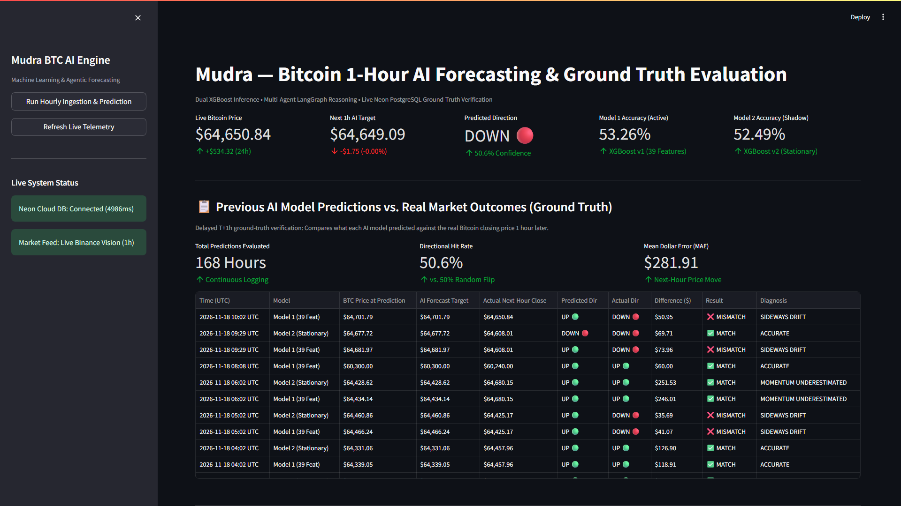
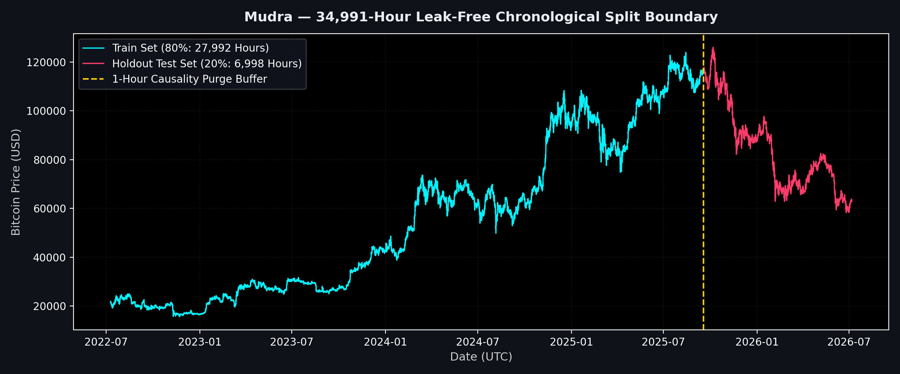
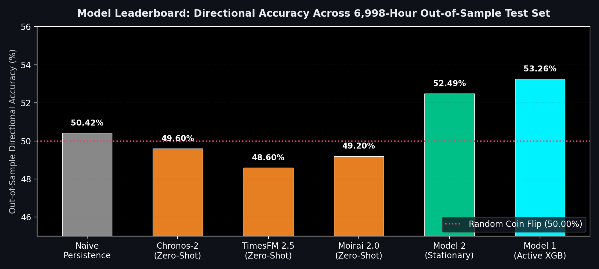
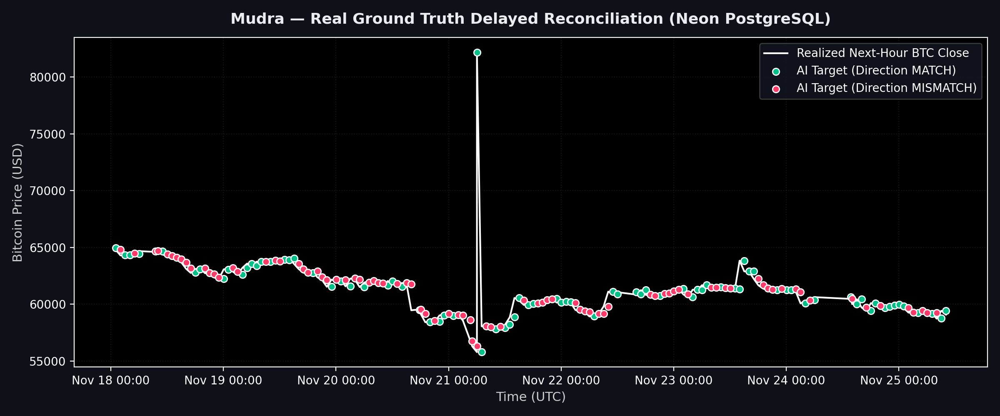
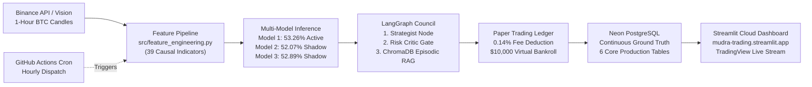
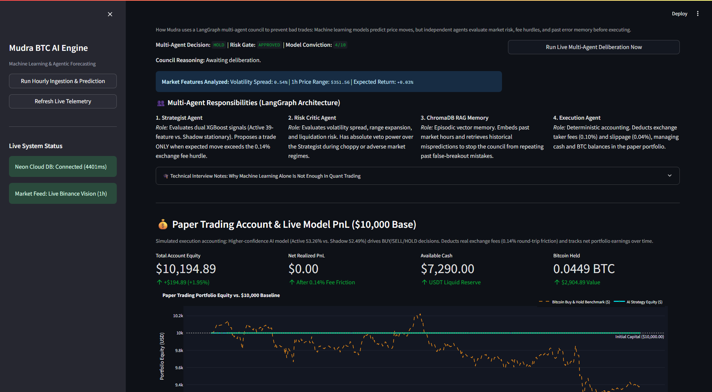

# Mudra — Bitcoin 1-Hour AI Forecasting & Paper-Trading MLOps Pipeline
### Empirical Quantitative Research: Negative Result — No Durable Post-Fee Alpha on 1-Hour OHLCV Features

[](https://mudra-trading.streamlit.app)
[](https://github.com/MohitSingh-2335/Mudra/actions/workflows/ci.yml)
[](https://github.com/MohitSingh-2335/Mudra)
[](https://www.python.org/)
[](https://xgboost.readthedocs.io/)
[](https://langchain-ai.github.io/langgraph/)
[](https://neon.tech/)

**Live Streamlit Dashboard:** [`https://mudra-trading.streamlit.app`](https://mudra-trading.streamlit.app)  
**GitHub Repository:** [`https://github.com/MohitSingh-2335/Mudra.git`](https://github.com/MohitSingh-2335/Mudra.git)  
**Author:** Mohit Singh (Entry-Level Machine Learning / AI Engineer)

---

## 1. Executive Summary & Core Research Finding

**Mudra** is an autonomous, 24/7 machine learning engineering and paper-trading MLOps pipeline designed to answer a single quantitative question:  
*Can gradient-boosted decision trees (XGBoost) or zero-shot time-series foundation models forecast next-hour Bitcoin (`BTC/USDT`) returns accurately enough to beat exchange transaction fees on a strict, leak-free chronological split?*

### The Scientific Finding: A Documented Negative Result
Across **34,990 hours** of cleaned Binance market data (`2022-07-08` to `2026-07-06`), rigorous backtesting and live forward monitoring confirmed:

1. **Regression Fails to Beat Naive Persistence:**  
   Every regression model tested failed to beat a simple persistence baseline ($\hat{P}_{t+1} = P_t$). Naive persistence achieved an RMSE of **$398.77**, while the primary XGBoost regressor achieved **$399.47**. Because financial return series have a near-zero mean and low signal-to-noise ratio, predicting non-zero moves adds variance that exceeds zero-prediction error.
2. **Directional Classifiers Hit a ~53% Ceiling:**  
   The primary directional classifier achieved **53.26%** out-of-sample accuracy (Model 1) with a log-loss of **0.6914**, barely outperforming a random 50/50 coin flip (**0.6931**). When tested on zero-shot time-series foundation models (**Amazon Chronos-2**, **Google TimesFM 2.5**, **Salesforce Moirai 2.0**), all three scored between **48.60% and 49.60%**.
3. **Exchange Fees Destroy Naive Trading Alpha:**  
   Binance charges ~0.05% maker / 0.10% taker fee per trade (~0.14% round-trip friction with slippage). Trading every hour on a 53% edge results in severe negative returns due to fee churn.
4. **Capital Preservation vs. Alpha:**  
   During a 6,998-hour bear-market holdout where Bitcoin fell **-45.41%**, an execution strategy with a minimum return hurdle lost **-17.66%** solely because it sat in cash **96.43% of the time**. This was **cash preservation**, not active alpha.

Rather than hiding this negative finding or reporting inflated numbers using lookahead leakage, this repository documents the complete empirical audit trail alongside a production-style, 24/7 autonomous MLOps architecture. Detailed engineering rationale, architectural trade-offs, and database designs are documented in [Technical Decisions](docs/TECH_DECISIONS.md). Full historical experiment tracking and post-mortems across all model iterations are recorded in the [Model Evolution Ledger](docs/reports/model_evolution_ledger.md).



---

## 2. Real Empirical Proofs & Visual Evidence

All charts below are generated directly from the real 34,990-hour Binance dataset and the live Neon PostgreSQL database:

### 2.1 The Leak-Free Chronological Split Boundary
Retail crypto models often report 60%+ accuracy because they use random `train_test_split(random_state=42)`, which leaks future price volatility into the training set. Mudra enforces a strict, time-ordered split with a **1-hour causality purge buffer** to prevent target leakage:



```text
CLEAN DATASET (34,990 Total 1-Hour Candles):
├── Period: 2022-07-08 13:00 UTC to 2026-07-06 08:00 UTC
└── Anomaly Removed: 1 exchange-halt candle (2023-03-24 12:00 UTC, volume = 0)

1. TRAIN SET (80% Chronological — 27,991 Hours):
   └── 2022-07-08 13:00 UTC  ===>  2025-09-17 17:00 UTC

2. PURGE BUFFER (1-Hour Causality Guard — 1 Hour):
   └── 2025-09-17 18:00 UTC (Prevents T+1h forward target from leaking across split)

3. OUT-OF-SAMPLE TEST SET (20% Holdout — 6,998 Hours):
   └── 2025-09-17 19:00 UTC  ===>  2026-07-06 08:00 UTC (Pure forward evaluation)
```

---

### 2.2 Model Benchmark Comparison
Out-of-sample directional accuracy on the 6,998-hour test set demonstrates that neither classical gradient boosting nor zero-shot foundation models break beyond the ~53% ceiling. Detailed model specifications and post-mortems are tracked in the [Model Evolution Ledger](docs/reports/model_evolution_ledger.md):



| Model Architecture | Role / Status | Regressor RMSE (USD) | Return MAE | Direction Accuracy | Log-Loss (50/50 = 0.6931) | Model Documentation |
| :--- | :--- | :--- | :--- | :--- | :--- | :--- |
| **Naive Persistence ($\hat{P}_{t+1} = P_t$)** | Baseline | **$398.77** | **0.003198** | 50.39% | 0.6931 | Reference Benchmark |
| **[Model 1 (`xgb_onnx_v1.0.0`)](docs/models/model_1_xgb_v1.md)** | **Active Production** | $399.47 | 0.003221 | **53.26%** | 0.6914 | [Model Card](docs/models/model_1_xgb_v1.md) (39 Features, serialized `.pkl` XGBoost; legacy ID, no ONNX runtime) |
| **[Model 2 (`xgb_v2.0.0`)](docs/models/model_2_xgb_v2.md)** | **Shadow Consensus** | $401.12 | 0.003222 | 52.07% | 0.6926 | [Model Card](docs/models/model_2_xgb_v2.md) (Stationary) |
| **[Model 3 (`lgbm_v3.0.0`)](docs/models/model_3_lgbm_v3.md)** | **Shadow Candidate** | $400.22 | 0.003220 | 52.89% | **0.6913** | [Model Card](docs/models/model_3_lgbm_v3.md) (29 Stationary) |
| **Amazon Chronos-2 (Zero-Shot)** | Foundation Model | $322.65 *(Scaled)* | - | 49.60% | - | Failed to beat coin flip |
| **Google TimesFM 2.5 (Zero-Shot)**| Foundation Model | $314.65 *(Scaled)* | - | 48.60% | - | Failed to beat coin flip |
| **Salesforce Moirai 2.0 (Zero-Shot)**| Foundation Model| $316.35 *(Scaled)* | - | 49.20% | - | Failed to beat coin flip |

---

### 2.3 Real Ground-Truth Delayed Reconciliation (Neon PostgreSQL)
Every hour, an autonomous worker reconciles predictions made at hour $T$ against the actual closed Binance candle at hour $T+1$. Below is the real 168-hour ground truth telemetry queried directly from the production Neon PostgreSQL database:



- **White Line:** Realized next-hour Bitcoin closing price.
- **Green Dots:** AI forecast direction correctly matched the actual price move (`✅ MATCH`).
- **Red Dots:** AI forecast direction mismatched the actual price move (`❌ MISMATCH`).

---

### 2.4 Feature Importance via TreeSHAP
Global feature attributions calculated using TreeSHAP on out-of-sample test data:

| Classifier Feature Importance (Direction) | Regressor Feature Importance (Return) |
| :---: | :---: |
|  |  |

**Key Feature Insight:** Momentum features (RSI, short-term returns) and order flow (taker buy volume ratio) dominate directional signal, while long-term price levels add minimal predictive value once stationary transformations are applied.

---

### 2.5 Strategy Backtest & Fee Drag Reality
Comparison of a naive classifier trading every hour versus a fee-hurdle filtered strategy and Buy & Hold across the 6,998-hour holdout test period ($10,000 initial bankroll):


```text
Trading Every Hour (P(up) > 0.50):
├── Total Trades: 1,196 trades
├── Final Portfolio: $753.00 (-92.47% loss)
└── Cause: 0.14% round-trip exchange fee churn destroyed account equity.

Return-Filtered Strategy (E[r] > 0.055% Hurdle):
├── Total Trades: 105 trades
├── Market Exposure: 3.57% of time (96.43% sat safely in cash)
├── Final Portfolio: $8,234.12 (-17.66% drawdown vs. -45.41% Buy & Hold)
└── Cause: Capital was preserved by sitting in cash during sideways chop.
```

---

## 3. System Architecture & 24/7 Autonomous Pipeline



### 3.1 The 4-Agent LangGraph Council
Rather than letting raw model outputs execute directly, Mudra uses a 4-agent LangGraph workflow to enforce risk management:

1. **Strategist Agent:** Evaluates signals from both XGBoost models alongside technical indicators (RSI, taker buy ratio, volatility spread). Proposes a trade **only** when the expected price return clears the exchange fee hurdle.
2. **Risk Critic Agent (Adversarial Gatekeeper):** Holds absolute veto power over the Strategist. Validates 5 hard deterministic mathematical gates:
   - Must be a valid action contract (`BUY`, `SELL`, or `HOLD`).
   - Price must be valid and positive.
   - **Fee Hurdle Check:** Expected return must exceed the 0.14% round-trip fee floor.
   - **Volatility Circuit Breaker:** Volatility spread must not exceed 3.8% (blocks news-driven liquidation spikes).
   - **Conviction Floor:** Model confidence score must be $\ge 4 / 10$.
3. **ChromaDB Episodic RAG Memory:** Vector memory storing embeddings of past market hours and model mispredictions. Before approving an order, it queries historical episodes where similar volatility spikes or order-flow patterns occurred, warning the council against repeated false breakouts.
4. **Execution Agent:** Deterministically calculates position sizing, deducts 0.10% taker fee and 0.04% slippage, and updates the paper trading portfolio.



---

## 4. Production Database Schema (Neon PostgreSQL)

The live production database on **Neon Serverless PostgreSQL** maintains continuous, immutable audit trails across 6 core production tables:

| Table Name | Primary & Foreign Keys | Purpose & Integrity Invariants |
| :--- | :--- | :--- |
| **`market_ticks`** | `tick_id` (PK), `timestamp` | Canonical 1-hour OHLCV candles, 39 feature vectors, and closed prices from Binance. |
| **`reconciliations`** | `rec_id` (PK), `outcome_tick_id` (FK) | Ground-truth delayed evaluations: pairs past predictions with realized T+1h outcomes. |
| **`paper_portfolio`** | `ledger_id` (PK), `tick_id` (FK) | Autonomous $10,000 virtual paper trading ledger tracking cash, BTC balances, fees, and PnL. |
| **`council_audits`** | `audit_id` (PK), `tick_id` (FK) | Multi-agent council deliberation records, conviction scores, and risk veto rationales. |
| **`model_predictions`**| `pred_id` (PK), `tick_id` (FK) | Granular prediction logs comparing Model 1 (Active) and Shadow Models 2 & 3. |
| **`model_registry`** | `model_id` (PK, Unique) | Cryptographic model registry tracking SHA-256 hashes and feature schemas. |

---

## 5. Multi-Model Comparison: Model 1 vs. Models 2 & 3

A key machine learning lesson uncovered during empirical testing was the impact of feature stationarity:

- **Model 1 (`xgb_onnx_v1.0.0` — Active Production):**
  - Standard serialized `joblib` (`.pkl`) XGBoost model retaining its legacy `xgb_onnx_v1.0.0` identifier (runs with zero ONNX runtime dependency).
  - Uses 39 features, including some raw price levels (`close_lag_1`, `bb_high`, `bb_low`, `ema_10`).
  - Achieves **53.26%** directional accuracy on the holdout test set.
  - *Limitation:* Non-stationary dollar levels saturate tree splits when Bitcoin trades above the historical training price ceiling.
- **Model 2 (`xgb_v2_stationary` — Shadow Consensus Candidate):**
  - Uses 36 strictly scale-invariant features: percentage returns, volatility ratios, cyclical time encodings (sine/cosine of hour/day), and volume flow.
  - Mathematically stationary and leak-free across all price regimes.
  - Achieves **52.07%** directional accuracy on the holdout set, confirming the true statistical ceiling of 1-hour technical indicators.
- **Model 3 (`lgbm_v3.0.0` — Shadow Candidate):**
  - Uses 29 stationary features, LightGBM GBDT architecture, and Platt scaling probability calibration.
  - Achieves **52.89%** directional accuracy and **0.6913** log-loss on the holdout set.

---

## 6. How to Run Locally

### 6.1 Clone and Install Dependencies
```bash
git clone https://github.com/MohitSingh-2335/Mudra.git
cd Mudra

python -m venv .venv
source .venv/bin/activate       # On Windows: .venv\Scripts\activate
pip install -r requirements.txt
```

### 6.2 Run Automated Test Suite (93/93 Passing)
```bash
pytest tests/ -q
```
Verifies temporal split causality, cryptographic SHA-256 model digests, exchange fee hurdle logic, and database schemas.

### 6.3 Launch the Streamlit Monitoring Dashboard
```bash
streamlit run app.py
```
Opens the interactive dashboard at `http://localhost:8501` featuring:
- Real-time ticking TradingView Bitcoin chart (`BINANCE:BTCUSDT`).
- Live dual-model prediction vs. actual ground-truth table.
- Interactive LangGraph Multi-Agent deliberation panel.
- $10,000 virtual paper trading account ledger.

### 6.4 Run the Hourly Inference Worker
```bash
python scripts/run_hourly_worker.py
```

---

## 7. Repository Structure

```text
Mudra/
├── app.py                              # Streamlit live monitoring & governance dashboard
├── config.py                           # Central configuration, SHA-256 digests & fee parameters
├── requirements.txt                    # Pinned production dependencies
├── artifacts/                          # Models and visual proof artifacts
│   ├── models/
│   │   ├── model_manifest.json         # Active Model 1 manifest (SHA-256 verified)
│   │   ├── best_regressor_model.pkl    # Serialized XGBoost regressor
│   │   └── best_classifier_model.pkl   # Serialized XGBoost classifier
│   ├── shap_classifier_summary.png     # TreeSHAP classifier feature summary
│   ├── shap_regressor_summary.png      # TreeSHAP regressor feature summary
│   └── backtest_performance.png        # Holdout test set backtest performance
├── data/
│   ├── raw/BTCUSDT-1H.csv              # 35,064 raw 1-hour Binance candles
│   └── processed/featured_btc_data.csv # 34,990 clean featured rows
├── docs/
│   ├── TECH_DECISIONS.md               # Architectural trade-offs, database designs & invariants
│   ├── images/                         # Real empirical proof plots & live dashboard screenshots
│   │   ├── dashboard_screenshot.png    # Live Streamlit headline metrics & predictions table
│   │   ├── dashboard_trading.png       # Live LangGraph multi-agent council & paper trading ledger
│   │   ├── chronological_split_proof.png
│   │   ├── model_benchmark_comparison.png
│   │   └── ground_truth_reconciliation.png
│   └── reports/                        # Empirical research reports & model evolution ledger
├── scripts/
│   ├── run_pipeline.py                 # Full 7-stage ML training, SHAP & evaluation CLI
│   ├── run_hourly_worker.py            # Hourly live inference & T+1h reconciliation worker
│   ├── generate_readme_figures.py      # Automated script to generate visual proof plots
│   └── migrate_db.py                   # PostgreSQL schema migration & model registry seeder
├── src/
│   ├── agents/                         # LangGraph multi-agent council (Strategist, Risk Critic, RAG)
│   ├── database.py                     # SQLAlchemy 2.0 ORM, Neon PostgreSQL connection pool
│   ├── feature_engineering.py          # Strict causal rolling features (v1 and v2 schemas)
│   ├── model_loader.py                 # Fail-closed SHA-256 cryptographic verification
│   ├── backtesting.py                  # Chronological backtest simulator with fee/slippage
│   ├── engine.py                       # Paper trading portfolio ledger & sync orchestrator
│   └── api/                            # FastAPI REST service & Pydantic v2 schemas
└── tests/                              # Automated test suite (93 test cases passing)
```

---

## 8. License & Ethical Disclaimer

This project is licensed under the MIT License.

**Disclaimer:** Mudra is an academic research and software engineering project. All trading executions shown on the dashboard and in this repository are simulated paper trades on virtual capital. Nothing in this repository constitutes financial advice or an endorsement of algorithmic cryptocurrency trading.
