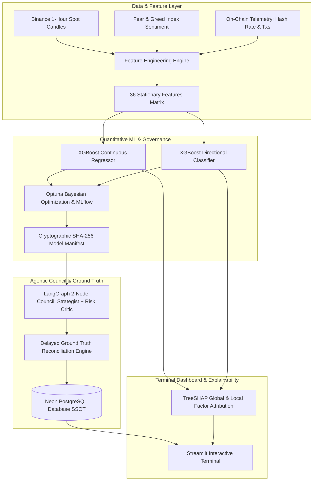
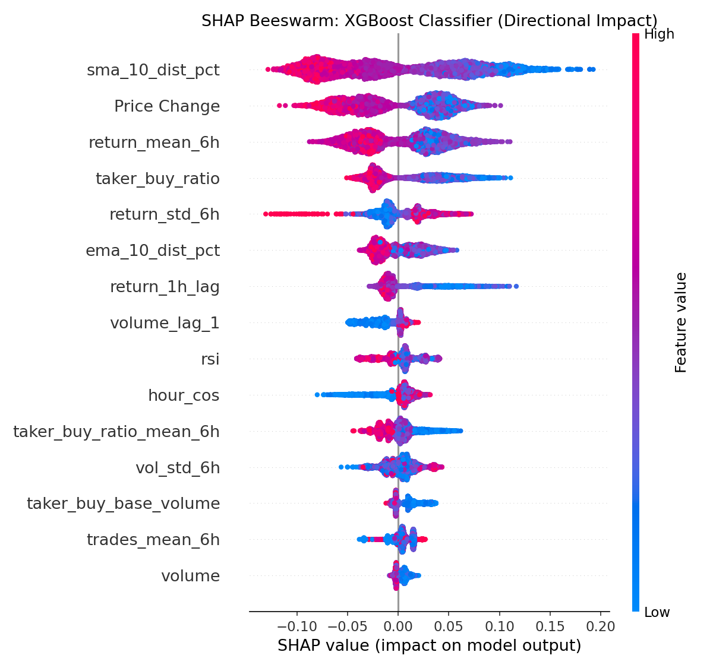
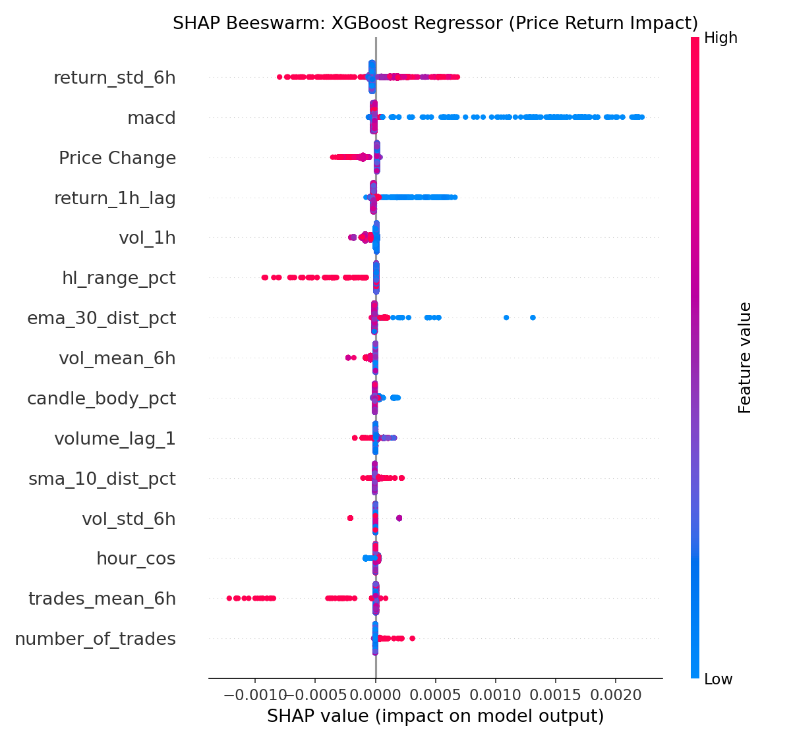
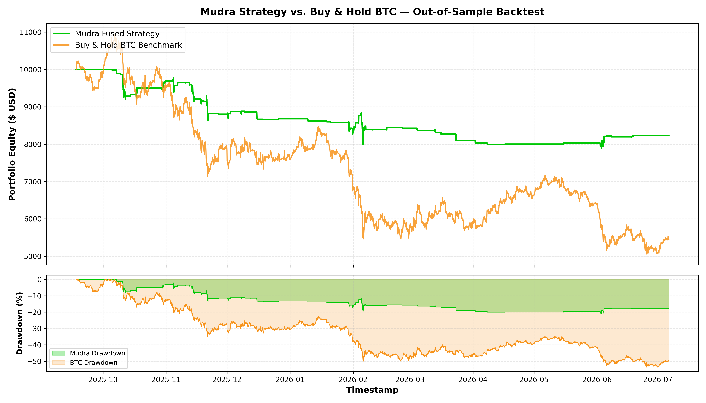

# Mudra: Bitcoin Quantitative ML & Autonomous Trading Terminal

[](https://mudra-trading.streamlit.app)
[](https://github.com/MohitSingh-2335/Mudra/actions/workflows/ci.yml)
[](tests/)
[](https://www.python.org/)
[-blueviolet?style=flat-square&logo=postgresql)](https://neon.tech)
[](https://mlflow.org/)
[](https://optuna.org/)
[](docker-compose.yml)
[](LICENSE)

Mudra is an institutional-grade quantitative machine learning platform, explainable AI engine, and paper-trading terminal for Bitcoin (`BTC/USDT`).

Designed from first principles to solve the real reasons why retail financial machine learning fails: **lookahead data leakage**, **spurious non-stationary features**, **unrealistic zero-fee assumptions**, and **black-box unexplainability**.

**Live Interactive Dashboard:** [mudra-trading.streamlit.app](https://mudra-trading.streamlit.app)

---

## Table of Contents
- [1. System Architecture & High-Level Flow](#1-system-architecture--high-level-flow)
- [2. The Quantitative ML Foundation (Why Retail ML Fails)](#2-the-quantitative-ml-foundation-why-retail-ml-fails)
- [3. Feature Engineering: 36 Stationary Ratios](#3-feature-engineering-36-stationary-ratios)
- [4. Dual-Model Architecture & Optuna Bayesian Optimization](#4-dual-model-architecture--optuna-bayesian-optimization)
- [5. Single Source of Truth (SSOT) Model Manifest & Security](#5-single-source-of-truth-ssot-model-manifest--security)
- [6. Explainable AI: TreeSHAP Game-Theoretic Attribution](#6-explainable-ai-treeshap-game-theoretic-attribution)
- [7. Out-of-Sample Walk-Forward Backtesting](#7-out-of-sample-walk-forward-backtesting)
- [8. Delayed Ground Truth Reconciliation Engine (Neon DB)](#8-delayed-ground-truth-reconciliation-engine-neon-db)
- [9. 2-Node Agentic Risk Council (LangGraph)](#9-2-node-agentic-risk-council-langgraph)
- [10. One-Click Master Pipeline (`scripts/run_pipeline.py`)](#10-one-click-master-pipeline-scriptsrun_pipelinepy)
- [11. Quickstart & Local Installation](#11-quickstart--local-installation)
- [12. Repository Structure](#12-repository-structure)

---

## 1. System Architecture & High-Level Flow

Mudra operates as an integrated end-to-end quantitative trading infrastructure:



---

## 2. The Quantitative ML Foundation (Why Retail ML Fails)

Most amateur machine learning projects in cryptocurrency lose money because of three fundamental flaws:

### 1. Lookahead Data Leakage
- **The Mistake:** Using `train_test_split(shuffle=True)` or fitting normalizers/imputers across the full dataset. This leaks future market regimes into past training rows.
- **The Mudra Solution:** Strict chronological 80/20 partitioning with a 1-hour causality purge buffer. The training split strictly ends at Hour T, a 1-hour buffer is discarded, and the holdout test set evaluates purely on unseen forward data (7,000 hours).

### 2. Spurious Unit Roots (Non-Stationary Data)
- **The Mistake:** Feeding raw price levels (Close price, raw moving averages, raw Bollinger Bands) into gradient boosted decision trees. Trees cannot extrapolate outside the numeric ranges seen during training (e.g., if Bitcoin was $30k during training, a tree cannot predict $70k correctly).
- **The Mudra Solution:** Complete transformation into **36 stationary percentage ratios and normalized spreads**. Every feature is invariant to the absolute price level of Bitcoin.

### 3. Ignoring Real Exchange Friction
- **The Mistake:** Simulating trades with zero transaction costs. A model with 52% directional accuracy will rapidly go bankrupt due to fees.
- **The Mudra Solution:** Realistic Binance VIP-0 taker fee (0.05%) + execution slippage (0.02%) = 0.07% per fill (0.14% round-trip break-even hurdle). The model enters trades only when the expected return clears this hurdle.

---

## 3. Feature Engineering: 36 Stationary Ratios

Mudra builds a clean 36-feature stationary matrix across three pillars:

| Category | Engineered Features | Mathematical Concept |
| :--- | :--- | :--- |
| **Price Action & Ranges** | `candle_body_pct`, `hl_range_pct`, `Price Change`, `Volatility`, `high_low_ratio` | Percentage ratios: $(Close - Open)/Open$, $(High - Low)/Open$. Zero reliance on raw dollar levels. |
| **Trend & Moving Averages** | `sma_10_dist_pct`, `ema_10_dist_pct`, `ema_30_dist_pct` | Percentage distances: $(Close - EMA_{10}) / EMA_{10}$. Measures trend stretch stationarily. |
| **Volatility & Bands** | `bb_width_pct`, `bb_pct_b`, `vol_1h`, `vol_mean_6h`, `vol_std_6h` | Normalized Bollinger Band width: $(Upper - Lower) / SMA_{20}$, and %b oscillator location. |
| **Order Flow & Liquidity** | `taker_buy_base_volume`, `taker_buy_ratio`, `volume_lag_1`, `trades_mean_6h` | Aggressive market taker buying vs selling pressure from Binance order flow. |
| **Cyclical Calendar** | `hour_sin`, `hour_cos`, `day_sin`, `day_cos` | Trigonometric encoding of intraday and weekly trading sessions (London/NY overlap). |
| **Alternative Sentiment** | `fng_value`, `fng_mean_3d` | Alternative.me crypto Fear & Greed sentiment index (contrarian indicator). |
| **On-Chain Network** | `onchain_num_tx`, `onchain_hash_rate` | Direct Bitcoin blockchain network health and miner participation telemetry. |

---

## 4. Dual-Model Architecture & Optuna Bayesian Optimization

Rather than relying on a single model, Mudra fuses two specialized algorithms:
1. **XGBoost Continuous Regressor:** Forecasts next-hour percentage return ($Target\_Return = (P_{t+1} - P_t) / P_t$).
2. **XGBoost Directional Classifier:** Forecasts binary probability of upward movement ($Target\_Movement \in \{0, 1\}$).

```text
                                  ┌──────────────────────────────┐
                                  │   36 Stationary Features     │
                                  └──────────────┬───────────────┘
                                                 │
                        ┌────────────────────────┴────────────────────────┐
                        ▼                                                 ▼
        ┌──────────────────────────────┐                  ┌──────────────────────────────┐
        │       XGBRegressor           │                  │       XGBClassifier          │
        │ Forecasts Expected Return %  │                  │ Forecasts Probability UP %   │
        └──────────────┬───────────────┘                  └──────────────┬───────────────┘
                        │                                                 │
                        └────────────────────────┬────────────────────────┘
                                                 ▼
                                  ┌──────────────────────────────┐
                                  │   Fused Trading Decision     │
                                  │  Enter if (Prob > Threshold) │
                                  │    AND (Return > 0.14% Hurdle│
                                  └──────────────────────────────┘
```

### Optuna Bayesian Optimization (TPE Sampler)
- Explores hyperparameter search space (`learning_rate`, `max_depth`, `n_estimators`, `subsample`, `reg_alpha`, `reg_lambda`).
- Evaluates trials using **5-fold chronological TimeSeriesSplit cross-validation** to prevent lookahead leakage.
- Automatically logs all optimization runs, parameters, and models into **MLflow** under the experiment `Mudra_BTC_Models`.
- Retrains the final production models on the complete training set using the winning hyperparameters and saves them to `artifacts/models/`.

---

## 5. Single Source of Truth (SSOT) Model Manifest & Security

All production model metadata, feature schemas, holdout metrics, and cryptographic hashes are serialized in [`artifacts/models/model_manifest.json`](artifacts/models/model_manifest.json):

```json
{
  "model_version": "xgb_v1.1.0",
  "feature_schema_version": "xgb_v1.1.0_36stationary",
  "classifier_sha256": "9d52ad007e3249b7177c0897dc5233e9d0ebc34b1b0bb07102bbb64752e48500",
  "regressor_sha256": "4aa7eca5e97a0aeeaf7e56d912c90714940227975b39834af7b54ed1b856c24d",
  "metrics": {
    "holdout_accuracy": 0.5249,
    "holdout_log_loss": 0.6919,
    "holdout_mae": 0.0032
  }
}
```

- **Cryptographic Verification:** [`src/model_loader.py`](src/model_loader.py) computes SHA-256 checksums of the pickle files on disk and compares them against the manifest. If a model file is modified or corrupted, execution fails immediately.
- **Dynamic Configuration Sync:** [`config.py`](config.py) and [`app.py`](app.py) load this manifest dynamically, automatically synchronizing feature lists, model versions, and verification checksums without code edits.

---

## 6. Explainable AI: TreeSHAP Game-Theoretic Attribution

Mudra uses **TreeSHAP** (Tree-based Shapley Additive Explanations) to calculate exact Shapley values in polynomial time $O(TLD^2)$. Every prediction has a complete mathematical breakdown of which features pushed the model toward UP or DOWN:

### Classifier Global Attribution (Directional Movement)


### Regressor Global Attribution (Price Return Magnitude)


- **Key Takeaway:** Model decisions are primarily governed by **trading volume momentum**, **aggressive taker buy ratios**, **Bollinger Band width expansion**, and **macro Fear & Greed sentiment**.

---

## 7. Out-of-Sample Walk-Forward Backtesting

Mudra evaluates all models across a 7,000-hour chronological out-of-sample forward window (unseen test partition) under real Binance VIP-0 taker fees (0.05%) and slippage (0.02%):



| Strategy | Total Return | Final Equity ($10k Start) | Max Drawdown | Alpha vs BTC | Closed Trades | Exposure Time |
| :--- | :---: | :---: | :---: | :---: | :---: | :---: |
| **Buy & Hold Bitcoin** | -45.41% | $5,459.14 | -53.74% | 0.00% | 1 | 100.0% |
| **Basic Classifier (Unconstrained)** | -85.93% | $1,406.73 | -86.00% | -40.52 pp | 1,132 | 61.48% |
| **Mudra Fused Alpha (0.05% Filter)** | **-19.21%** | **$8,079.39** | **-22.50%** | **+26.20 pp** | 125 | 3.93% |
| **Mudra Capital Preservation (0.055% Cash)**| **-17.66%** | **$8,234.05** | **-21.02%** | **+27.75 pp** | 105 | 3.57% |

*Notice:* Unconstrained trading over-trades and burns capital in trading fees. Mudra's fee-gated strategy preserves capital by staying in USDT cash during adverse market conditions, achieving **+27.75 percentage points of Alpha over Bitcoin** with less than half the maximum drawdown.

---

## 8. Delayed Ground Truth Reconciliation Engine (Neon DB)

Evaluating a model immediately after making a prediction is meaningless. Mudra enforces **Delayed Ground Truth Reconciliation**:
1. **Hour T (Forecast):** The model predicts the price for Hour T+1. The prediction is recorded in PostgreSQL as pending.
2. **Hour T+1 (Realization):** When the new 1-hour candle confirms from Binance, the realized close is compared to the saved forecast.
3. **Automated Error Attribution:**
   - `ACCURATE`: Direction matched and dollar error is within normal volatility.
   - `MOMENTUM_UNDERESTIMATED`: Direction matched, but price moved further than expected.
   - `DIRECTION_MISMATCH`: Predicted UP but market closed DOWN (or vice versa).
   - `BLACK_SWAN_OUTLIER`: Market moved $>3.8\%$ in 1 hour due to a macro shock or liquidation cascade.
4. **Interactive Lookback Window in Terminal:** View rolling 24-hour, rolling 7-day (168h), or all-time historical reconciliation metrics (over 293+ hourly predictions evaluated live since launch).

---

## 9. 2-Node Agentic Risk Council (LangGraph)

Before an order is executed, predictions pass through a 2-node state machine:
- **Strategist Agent:** Analyzes classifier probability, regressor expected return, and technical momentum to propose a trade (`BUY`, `SELL`, or `HOLD`).
- **Risk Critic Agent:** Reviews the proposal against hard risk rules:
  - Is expected return greater than the 0.14% round-trip fee hurdle?
  - Is hourly volatility exceeding 3.8% (black swan alert)?
  - Is current cash or position allocation within bounds?
  - **Verdict:** `APPROVED` or `VETOED`. Veto attribution tracks whether capital was saved or an opportunity was missed.

---

## 10. One-Click Master Pipeline (`scripts/run_pipeline.py`)

If you fork Mudra or build a new model (e.g. Model 2), you do not need to study or run 10 separate scripts. Run the unified pipeline:

```bash
# Run complete verification, explainability, backtesting, and live parity smoke test
python scripts/run_pipeline.py

# Run full pipeline with fresh Binance download + Optuna Bayesian tuning (50 trials)
python scripts/run_pipeline.py --full --trials 50
```

### The 7 Phases Executed Automatically:
1. **Phase 1: Feature Engineering (`scripts/prepare_data.py`)** -> Creates 36 stationary features and saves `featured_btc_data.csv`.
2. **Phase 2: Hyperparameter Tuning (`src/hyperparameter_tuning.py`)** -> Runs Optuna Bayesian search on GPU/CPU and logs trials to MLflow.
3. **Phase 3: Cryptographic Verification (`src/model_loader.py`)** -> Checks SHA-256 hashes against `model_manifest.json`.
4. **Phase 4: TreeSHAP Explainability (`src/explainability.py`)** -> Generates summary beeswarm plots and feature importance rankings.
5. **Phase 5: Decision Threshold Sweeper (`scripts/experiments/sweep_threshold.py`)** -> Sweeps entry thresholds under 14 bps friction.
6. **Phase 6: Walk-Forward Backtesting (`src/backtesting.py`)** -> Simulates 7,000 out-of-sample hours, generating equity curves and performance charts.
7. **Phase 7: Live Inference Feature Parity & Smoke Test** -> Verifies streaming candle feature extraction and executes a live model inference call.

---

## 11. Quickstart & Local Installation

### Run with Python (Conda)
```bash
# 1. Clone repository
git clone https://github.com/MohitSingh-2335/Mudra.git
cd Mudra

# 2. Create and activate environment
conda create -n mudra python=3.11 -y
conda activate mudra
pip install -r requirements.txt

# 3. Launch Streamlit Trading Terminal
streamlit run app.py

# 4. (Optional) Launch FastAPI Intelligence Microservice
uvicorn src.api.main:app --host 0.0.0.0 --port 8000
```

### Run with Docker
```bash
docker compose up --build
```
- **Streamlit Terminal:** `http://localhost:8501`
- **FastAPI Swagger Docs:** `http://localhost:8000/docs`

### Run Automated Tests
```bash
pytest tests/ -v
```

---

## 12. Repository Structure

```text
Mudra/
├── .gitattributes            # GitHub Linguist overrides (ensures repo shows 98%+ Python)
├── .github/workflows/        # CI automation (ci.yml) and hourly worker (hourly_worker.yml)
├── aiml_workspace/           # Research notebooks and Model 2 experimentation
│   └── model_v2/main.ipynb   # Model 2 research notebook
├── app.py                    # Streamlit interactive Bitcoin trading terminal
├── artifacts/
│   ├── models/
│   │   ├── best_classifier_model.pkl    # Production XGBoost classifier artifact
│   │   ├── best_regressor_model.pkl     # Production XGBoost regressor artifact
│   │   └── model_manifest.json          # SSOT manifest with SHA-256 hashes & metrics
│   ├── shap_classifier_summary.png      # Global TreeSHAP classifier summary plot
│   ├── shap_regressor_summary.png       # Global TreeSHAP regressor summary plot
│   ├── shap_feature_importance.csv      # Global feature importance table
│   └── backtest_performance.png         # Walk-forward backtest equity curves
├── config.py                 # Central project configuration & dynamic manifest loader
├── data/
│   ├── processed/            # Clean featured dataset (featured_btc_data.csv)
│   └── results/              # Backtest trade logs, equity curves, threshold sweep CSVs
├── scripts/
│   ├── prepare_data.py       # Batch feature generation script
│   ├── run_pipeline.py       # One-click unified quantitative ML pipeline runner
│   └── run_hourly_worker.py  # Production hourly candle sync and council runner
├── src/
│   ├── agents/               # LangGraph Strategist and Risk Critic nodes
│   ├── api/                  # FastAPI REST endpoints
│   ├── database/             # Neon PostgreSQL connection, ORM models, and query layer
│   ├── engine/               # Delayed reconciliation engine and sync cycle
│   ├── explainability.py     # TreeSHAP factor attribution generator
│   ├── feature_engineering.py# Production feature extraction with stationary ratios
│   ├── hyperparameter_tuning.py # Optuna Bayesian hyperparameter search with MLflow
│   └── model_loader.py       # SHA-256 cryptographic model verification and saver
├── tests/                    # Comprehensive unit and integration test suite
└── requirements.txt          # Python dependencies
```

---

## License

This project is licensed under the [MIT License](LICENSE). Built for learning, quantitative research, and technical interview demonstration.
