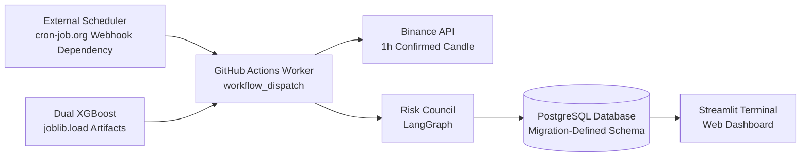

# Mudra: Bitcoin Quantitative ML & Autonomous Trading Terminal

[](https://mudra-trading.streamlit.app)
[](https://github.com/MohitSingh-2335/Mudra/actions/workflows/ci.yml)
[](tests/)
[](https://www.python.org/)
[](https://neon.tech)
[](docker-compose.yml)
[](LICENSE)

Mudra is an experimental machine learning trading research and paper-trading platform for Bitcoin (`BTC/USDT`). It uses dual XGBoost models (return regression and direction classification), a 2-node risk evaluation council, delayed prediction verification, and an automated paper trading ledger backed by PostgreSQL.

**Live Web Application:** [mudra-trading.streamlit.app](https://mudra-trading.streamlit.app)

---

## Project Overview

Most machine learning models for crypto fail in real markets because of two common mistakes:
1. **Data Leakage (Lookahead Bias):** Randomly shuffling time-series data lets future price patterns leak into training. Mudra uses a strict chronological split: training on past data (2021 to mid-2025) and testing on 7,000 out-of-sample hours (mid-2025 to 2026).
2. **Ignoring Trading Fees:** Trading on every small signal burns capital quickly through exchange taker fees (0.05% per side) and slippage (0.02% per side, or 0.07% per fill). Mudra only enters an active trade when the model's expected return clears the canonical ~0.14% (`0.139951%`) round-trip break-even hurdle rate.

### Historical Backtest Results & Research Limitations

The performance comparison below is a **historical, single-split research result** from the initial classical model backtesting study ([`docs/reports/classical_model_backtesting.md`](docs/reports/classical_model_backtesting.md)). It does **not** represent current live performance, verified predictive alpha, or profitable trading.

* **Single-Split Backtest Context:** Over a held-out 7,000-hour test window (mid-2025 to 2026) where Bitcoin experienced a severe market drawdown (**-45.24%**), a fee-hurdle gated strategy achieved a return of **-11.69%** (a relative +33.55 percentage-point gap over Buy & Hold).
* **Friction Assumption:** This historical run evaluated an older **0.30% round-trip friction** assumption (0.10% taker fee + 0.05% slippage per side). This legacy benchmark cannot be directly compared to runs evaluated under the current canonical ~0.14% (`0.139951%`) hurdle rate.
* **Cash-Preservation, Not Predictive Edge:** The apparent relative advantage was substantially driven by remaining in USDT cash during a bear market (0.77% market exposure across only 49 trades), rather than market-timing precision.
* **Walk-Forward Failure to Replicate:** When the winning high-threshold configuration was evaluated across 5 independent, non-overlapping walk-forward windows (2022–2026), the strategy beat Buy & Hold in **only 1 of 5 windows**, with a cross-window mean return of **-0.52%** (centered on zero). Raising the threshold merely reduced sample size until noise appeared as a pattern, confirming that the classical models did not exhibit a durable directional edge after transaction costs.

| Strategy | Total Return | Max Drawdown | Total Trades | Exposure Time |
| :--- | :---: | :---: | :---: | :---: |
| **Buy & Hold Bitcoin** | -45.24% | -53.74% | 1 | 100.0% |
| **Basic Classifier (No Fee Filter)** | -97.56% | -97.56% | 1,237 | 57.9% |
| **Historical Gated Strategy (Legacy 0.30% Friction)** | **-11.69%** | **-11.69%** | **49** | **0.77%** |


---

## System Architecture

Mudra runs automatically every hour in a clean, decoupled pipeline:



### How the Pipeline Works:
1. **Trigger:** The worker workflow (`.github/workflows/hourly_worker.yml`) is configured for on-demand execution (`workflow_dispatch`). Automated recurring execution relies on an external scheduler (`cron-job.org`) dispatching the GitHub Actions workflow, which is an external configuration dependency.
2. **Data & Features:** The worker downloads the latest confirmed 1-hour candle from Binance and builds 26 regression and 39 classification features across price action, order flow, sentiment, and on-chain telemetry.
3. **ML Inference:** The API loads the regressor and classifier from configured pickle artifact paths (`artifacts/models/best_regressor_model.pkl` and `artifacts/models/best_classifier_model.pkl`) using `joblib.load`. A model-version identifier (`xgb_onnx_v1.0.0`) is exposed by the health and prediction endpoints for provenance tracking (serving utilizes scikit-learn/XGBoost, not ONNX runtime; artifact paths are statically configured rather than dynamically selected by registry query).
4. **Risk Review:** A 2-node LangGraph council checks if the return clears the canonical fee hurdle (~0.14%) and verifies volatility limits.
5. **Reconciliation:** The worker evaluates the prediction made in the previous hour ($T-1$) against the actual candle close at hour $T$, tagging accuracy and errors.
6. **Database Persistence:** Ticks, audit decisions, paper portfolio balances, and reconciliation results are recorded in the PostgreSQL database schema.

---

## Core Technologies

* **Machine Learning:** Dual XGBoost models (return regression and direction classification) tuned with Optuna Bayesian optimization, loaded from configured pickle paths via `joblib.load`.
* **Explainability:** TreeSHAP for calculating game-theoretic feature importance on predictions.
* **Agentic Risk Council:** LangGraph state graph with a Strategist node and a Risk Critic node.
* **Database Schema:** PostgreSQL migration specification defining 9 application tables (`market_ticks`, `api_telemetry`, `council_audits`, `reconciliations`, `paper_portfolio`, `model_registry`, `model_lifecycle_events`, `model_predictions`, `prediction_investigations`). *(Note: The 9-table schema is defined in migration scripts and validated in isolated CI testing; production database migrations have not yet been applied).*
* **Serving & Frontend:** FastAPI for REST endpoints, Streamlit for the terminal interface.
* **Continuous Integration & Containers:** GitHub Actions workflow running automated PyTest suites and validating Docker image builds; Docker and Docker Compose configurations for containerized runtime.

---

## Quickstart

### Run with Docker (Recommended)
```bash
git clone https://github.com/MohitSingh-2335/Mudra.git
cd Mudra
docker compose up --build
```
* Dashboard: `http://localhost:8501`
* API Docs: `http://localhost:8000/docs`

### Run Locally with Python
```bash
conda create -n mudra python=3.11 -y
conda activate mudra
pip install -r requirements.txt

# 1. Launch Streamlit Terminal Dashboard
streamlit run app.py

# 2. Launch FastAPI Intelligence Microservice
uvicorn src.api.main:app --host 0.0.0.0 --port 8000

# 3. Trigger Hourly Ingestion & Reconciliation Worker Manually
python scripts/run_hourly_worker.py --force
```

### Run Automated Tests
```bash
pytest tests/ -v
```
* **Local Working-Tree Validation:** **444 passed, 14 skipped** (the 14 skips require an active PostgreSQL connection via `TEST_DATABASE_URL`).
* **Continuous Integration Baseline:** The GitHub Actions CI workflow (`.github/workflows/ci.yml`) executes the test suite against an isolated PostgreSQL 16 service container. In the reviewed CI baseline run at commit `d7df431`, the test job succeeded with **457 passed tests** reported (including the 14 PostgreSQL integration tests).
* **Current Working Tree:** The current working tree contains one additional API test (`test_health_and_predict_model_version_provenance_parity` in `tests/test_api.py`), bringing the local test collection to 458 tests. This additional test has not yet been validated by a remote CI run.

---

## Details & Explanations

<details>
<summary><b>Delayed Ground Truth Reconciliation</b></summary>

<br>

Evaluating a price prediction at the moment it is made does not reflect reality. Mudra enforces delayed reconciliation:
* **At Hour T:** The model predicts where the price will be at Hour T+1. This is stored as pending.
* **At Hour T+1:** Once the new candle confirms, the actual price is compared to the saved prediction.
* **Error Categories:**
  * `ACCURATE`: Direction matched and price error is under 1.5%.
  * `DIRECTION_MISMATCH`: Predicted UP but market went DOWN (or vice versa).
  * `MAGNITUDE_ERROR`: Direction matched but price moved further than expected.
  * `BLACK_SWAN_OUTLIER`: Price moved more than 3.8% in a single hour.

</details>

<details>
<summary><b>TreeSHAP Feature Importance</b></summary>

<br>

Mudra uses TreeSHAP so every prediction has a clear mathematical explanation.


Top drivers of model decisions:
1. **Trading Volume (`volume`, `vol_mean_6h`):** High volume confirms trend strength, while low volume warns of fake breakouts.
2. **Taker Buy Ratio:** Measures whether aggressive buyers or sellers dominate the order flow.
3. **Fear & Greed Index (`fng_value`):** Macro sentiment indicator used to catch oversold and overbought conditions.

</details>

<details>
<summary><b>FastAPI Endpoints</b></summary>

<br>

Interactive documentation is available at `http://localhost:8000/docs` when running the API:

* `GET /health` — Check server and model status.
* `POST /predict` — Run inference on price and technical features.
* `POST /explain` — Get TreeSHAP feature contributions for a prediction.
* `POST /agents/trade` — Run the 2-node LangGraph risk council.
* `GET /reconciliation/summary` — Fetch current accuracy rate and error counts.
* `GET /portfolio/summary` — Fetch paper portfolio value, cash, and Alpha.

</details>

<details>
<summary><b>Repository Structure</b></summary>

<br>

```text
Mudra/
├── .github/workflows/       # Continuous integration (ci.yml) and hourly worker (hourly_worker.yml)
├── archive/                 # Historical planning documents and blueprints
├── artifacts/models/        # Configured XGBoost regressor and classifier pickle artifacts
├── data/                    # Raw and processed historical datasets
├── docs/                    # System documentation and historical research reports
│   └── reports/             # Classical backtesting, foundation model, sentiment, and on-chain evaluations
├── experiments/             # Walk-forward CV scripts & foundation model evaluations
├── src/
│   ├── agents/              # LangGraph Strategist and Risk Critic nodes
│   ├── api/                 # FastAPI routes and Pydantic schemas
│   ├── database/            # PostgreSQL connection and SQLAlchemy ORM models (9-table schema)
│   ├── engine/              # Reconciliation engine and hourly sync logic
│   ├── explainability.py    # TreeSHAP explainer module
│   └── ui/                  # Plotly chart visualizers
├── tests/                   # 458 automated tests (API endpoints, agent nodes, database ORM & migrations)
├── scripts/                 # Migration scripts and run_hourly_worker.py runner
├── app.py                   # Streamlit web dashboard
├── config.py                # Central project configuration and feature schemas
├── docker-compose.yml       # Docker Compose setup for API and UI
└── requirements.txt         # Project dependencies
```

</details>

---

## License

This project is licensed under the [MIT License](LICENSE). Built for educational and research purposes.
