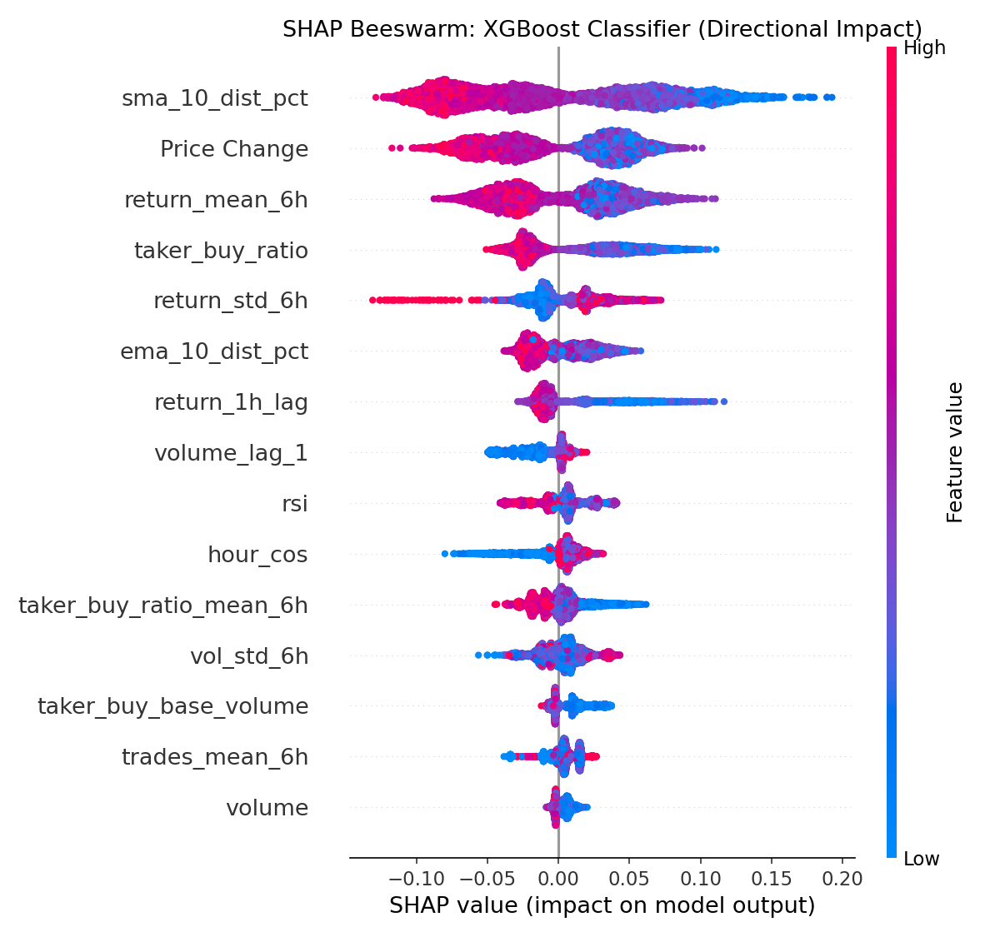
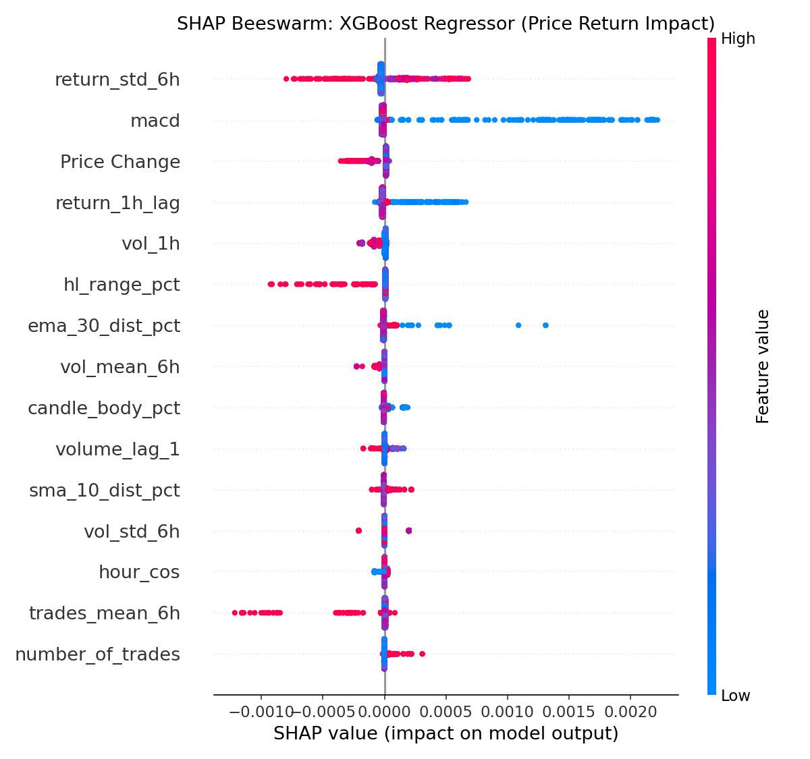
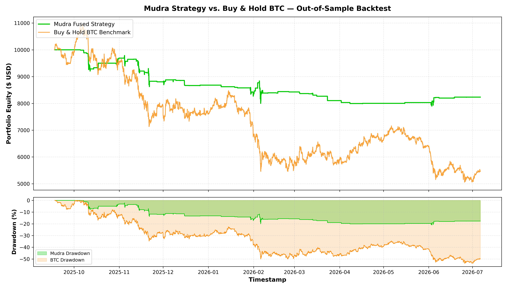
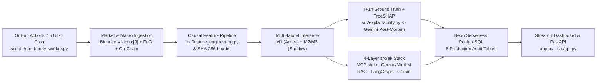

# Mudra — Bitcoin 1-Hour ML Forecasting & Autonomous MLOps Platform

**Can tabular GBDTs or zero-shot time-series foundation models forecast next-hour `BTC/USDT` returns cleanly enough to beat exchange transaction costs?**  
Across **34,990 hours** of Binance market data under a strict leak-free chronological split, Bonferroni multiple-comparison correction, and walk-forward validation, **the honest answer is no**: persistence wins on price RMSE (`$398.77`), directional accuracy plateaus at **53.26%**, and **`~0.14%` round-trip execution friction** erases naive hourly trading edge. Mudra pairs that documented negative result with an autonomous 24/7 Neon PostgreSQL ground-truth evaluation loop, `T+1h` per-row TreeSHAP Gemini post-mortems, and a 4-layer `src/ai/` LangGraph + MCP + ChromaDB stack.

[](https://mudra-trading.streamlit.app)
[](https://github.com/MohitSingh-2335/Mudra/actions/workflows/ci.yml)
[](https://github.com/MohitSingh-2335/Mudra/actions/workflows/hourly_worker.yml)
[](https://github.com/MohitSingh-2335/Mudra)
[](https://www.python.org/)
[](https://langchain-ai.github.io/langgraph/)
[](https://neon.tech/)

**Live Dashboard:** [`https://mudra-trading.streamlit.app`](https://mudra-trading.streamlit.app) · **Repository:** [`https://github.com/MohitSingh-2335/Mudra.git`](https://github.com/MohitSingh-2335/Mudra.git) · **Author:** Mohit Singh

---

## 1. Chronological Split & Empirical Verdict

To prevent lookahead leakage common in shuffled `train_test_split` crypto benchmarks, Mudra enforces strict chronological partitioning with a **1-hour causality purge buffer** and `D-1` day-lagged macro/on-chain joins:


```text
CLEAN DATASET (34,990 Validated 1-Hour BTC/USDT Candles, 2022-07-08 to 2026-07-06):
├── Train Partition (80% — 27,991 Hours) : 2022-07-08 13:00 UTC -> 2025-09-17 17:00 UTC
├── Purge Buffer    (1-Hour Target Guard): 2025-09-17 18:00 UTC (excluded)
└── Holdout Test    (20% — 6,998 Hours)  : 2025-09-17 19:00 UTC -> 2026-07-06 08:00 UTC
```

**Core Findings (6,998-Hour Locked Holdout):**
- **Regression Ceiling:** None of the GBDT or foundation models beat Naive Persistence (`$398.77` RMSE, `0.003198` return MAE) because 1-hour BTC returns are near-zero mean with low signal-to-noise ratio.
- **Directional Ceiling (~53%):** Model 1 reached **53.26%** directional accuracy (`0.6914` log-loss vs. `0.6931` coin flip); stationary LightGBM Model 3 achieved best log-loss (**0.6913**) and rank correlation (**+0.0211** Spearman IC, `p = 0.0772`). All three zero-shot foundation models scored **48.60%–49.60%**.
- **Execution Friction Floor (`~0.14%` Round-Trip):** Configured with **`0.05%` taker fee + `0.02%` slippage per side** (`0.07%` per side, `0.13995%` round-trip hurdle in [`config.py`](config.py)). Trading hourly without a hurdle lost **-92.47%** over 1,196 trades, while live expected moves remain sub-hurdle (`max |pred_ret| < 0.05%`), keeping the automated paper ledger safely in cash (`HOLD`).

---

## 2. Model Evolution & Research Benchmarks


| Model / Baseline | Role | Features & Calibration | Regressor RMSE (USD) | Return MAE | Dir. Accuracy | Log-Loss | Details |
| :--- | :--- | :--- | :---: | :---: | :---: | :---: | :--- |
| **Naive Persistence** | Baseline | $\hat{P}_{t+1} = P_t$ | **$398.77** | **0.003198** | 50.39% | 0.6931 | [Model Evolution Ledger](docs/reports/model_evolution_ledger.md) |
| **Model 1 (`xgb_onnx_v1.0.0`)** | Active Production | 39 Clf / 26 Reg (`.pkl` XGBoost; legacy ID) | $399.47 | 0.003221 | **53.26%** | 0.6914 | [Model 1 Card](docs/models/model_1_xgb_v1.md) |
| **Model 2 (`xgb_v2.0.0`)** | Live Shadow | 36 features (raw price levels pruned) | $401.12 | 0.003222 | 52.07% | 0.6926 | [Model 2 Card](docs/models/model_2_xgb_v2.md) |
| **Model 3 (`lgbm_v3.0.0`)** | Shadow Candidate | 29 strictly stationary + Platt sigmoid | $400.22 | 0.003220 | 52.89% | **0.6913** | [Model 3 Card](docs/models/model_3_lgbm_v3.md) |
| **Amazon Chronos-2** | Zero-Shot TSFM | Rolling 1-step (`amazon/chronos-2`) | $322.65 *(subset vs $310.06 naive)* | — | 49.60% | — | [Foundation Eval](docs/reports/foundation_model_zero_shot_evaluation.md) |
| **Google TimesFM 2.5** | Zero-Shot TSFM | Rolling 1-step (`timesfm-2.5-200m`) | $314.65 *(subset vs $310.06 naive)* | — | 48.60% | — | [Foundation Eval](docs/reports/foundation_model_zero_shot_evaluation.md) |
| **Salesforce Moirai 2.0** | Zero-Shot TSFM | Rolling 1-step (`moirai-2.0-R-small`) | $316.35 *(subset vs $310.06 naive)* | — | 49.20% | — | [Foundation Eval](docs/reports/foundation_model_zero_shot_evaluation.md) |

**Phase Evaluation Reports:** [Classical Model Backtesting](docs/reports/classical_model_backtesting.md) · [Foundation Model Zero-Shot Evaluation](docs/reports/foundation_model_zero_shot_evaluation.md) · [Fear & Greed Feature Evaluation](docs/reports/fear_greed_feature_evaluation.md) · [On-Chain Metrics Evaluation](docs/reports/onchain_metrics_evaluation.md)

### TreeSHAP Attribution & Fee-Hurdle Backtest Proof

| Classifier Feature Importance (Direction) | Regressor Feature Importance (Return) |
| :---: | :---: |
|  |  |

*Holdout TreeSHAP summaries (`v1_39features`): short-horizon order flow (`taker_buy_ratio`), intra-candle volatility, and momentum dominate signal; Model 2 and Model 3 progressively strip drifting dollar scales into scale-invariant ratios and log z-scores.*



*6,998-hour chronological holdout backtest (`$10,000` initial capital): trading every classifier signal loses `-92.47%` over 1,196 trades under round-trip exchange friction, whereas expected-return hurdle gating preserves capital (`-17.66%` vs. `-45.41%` BTC buy-and-hold).*

### Live Ground-Truth Reconciliation Proof (Neon PostgreSQL)


*Live trailing `T+1h` reconciliation queried directly from Neon PostgreSQL (`market_ticks` vs. `reconciliations`): green markers indicate correct directional calls (`UP`/`DOWN`) and red markers indicate directional mismatches.*

---

## 3. 4-Layer AI (`src/ai/`) & Production MLOps Architecture



### Modular 4-Layer Agent Stack (`src/ai/`)
- **Layer 1 — LLM & Structured Post-Mortems ([`src/ai/llm.py`](src/ai/llm.py)):** Official `google-genai` SDK candidate fallback (`gemini-3.1-flash-lite` chain), strict Pydantic schemas (`HourlyPostmortemOutput`, `MarketAnalystReport`), LangSmith `@traceable` secret bridging, HTTP `429` cooldowns, and per-model `api_telemetry` tracking.
- **Layer 2 — Real FastMCP `stdio` Client ([`src/ai/mcp_client.py`](src/ai/mcp_client.py), [`src/mcp_server.py`](src/mcp_server.py)):** Spawns the FastMCP server over `mcp_stdio` with isolated per-tool timeouts (`6s` for Deribit/Kraken perpetual funding & 6h CryptoCompare/RSS headlines; `8s` for Neon error memories) so slow DB wakes never starve live market feeds.
- **Layer 3 — Hybrid Dual-Collection RAG ([`src/ai/rag.py`](src/ai/rag.py)):** Uses Google `gemini-embedding-001` (`768`-dim, `mudra_rag_gemini_v1`) as primary semantic retriever and automatically falls back to local CPU ONNX MiniLM (`384`-dim `local_minilm`, `mudra_rag_minilm_v1`) under a 15-minute cooldown if Gemini hits HTTP `429`, recovering automatically once quota resets without mixing vector dimensions.
- **Layer 4 — 2-Node LangGraph Council ([`src/ai/workflow.py`](src/ai/workflow.py)):** `StateGraph` (`strategist_node` -> `risk_critic_node`) with deterministic fee-hurdle and `3.8%` volatility risk gates. Uses `use_llm=False` in automated hourly cycles to preserve quota and `use_llm=True` with multi-model classifier consensus for on-demand UI/API deliberations.

### Production MLOps Invariants & Neon Schema
- **Artifact & Feature Integrity:** Fail-closed SHA-256 verification before `joblib` deserialization ([`src/model_loader.py`](src/model_loader.py)) and strict schema/NaN/order enforcement prior to inference ([`src/feature_engineering.py`](src/feature_engineering.py)).
- **8-Table Neon PostgreSQL Store ([`src/database.py`](src/database.py)):** `market_ticks`, `model_predictions` (M1/M2/M3 rows), `reconciliations`, `hourly_postmortems` (Gemini diagnosis JSON + per-row TreeSHAP drivers + headlines), `council_audits`, `paper_portfolio` (advisory-locked execution ledger), `api_telemetry`, and `model_registry`.
- **Architecture Deep Dive:** See [`docs/TECH_DECISIONS.md`](docs/TECH_DECISIONS.md) for trade-offs, fail-closed design rationale, and database invariants.

---

## 4. Quick Start & Repository Layout

### Setup & Verification
```bash
git clone https://github.com/MohitSingh-2335/Mudra.git
cd Mudra

pip install -r requirements.txt
pytest tests/ -q                     # 94 passed (causality, SHA-256, engine, DB, AI layers)
streamlit run app.py                 # Dashboard at http://localhost:8501
uvicorn src.api:app --port 8000      # FastAPI endpoints (/health, /predict, /explain, /analyze, /agents/trade)
python scripts/run_hourly_worker.py  # Single ingestion, M1/M2/M3 inference, T+1h reconciliation & audit cycle
```

### Repository Structure
```text
Mudra/
├── app.py                        # Streamlit Cloud live monitoring UI (4 tabs + telemetry)
├── config.py                     # Fee friction rates, SHA-256 digests, feature schemas, Chroma config
├── Dockerfile / docker-compose.yml
├── requirements.txt
├── .github/workflows/
│   ├── ci.yml                    # Pytest suite + Docker image build validation
│   ├── hourly_worker.yml         # Autonomous :15 UTC ingestion, reconciliation & post-mortem cron
│   └── keep_streamlit_awake.yml  # Periodic health ping for hosted dashboard
├── artifacts/models/             # SHA-256 verified M1/M2/M3 artifacts & JSON manifests
├── data/                         # Cleaned 34,990-row dataset, backtest & zero-shot CSV results
├── docs/
│   ├── TECH_DECISIONS.md         # Architecture & MLOps design decisions
│   ├── models/                   # Standardized Model Cards (M1, M2, M3)
│   ├── reports/                  # Phase evaluations & Model Evolution Ledger
│   └── images/                   # Proof figures
├── scripts/
│   ├── run_hourly_worker.py      # Production hourly worker CLI
│   ├── run_pipeline.py           # Training, evaluation & SHAP generation pipeline
│   ├── migrate_db.py             # Schema verification & model registry seeder
│   └── generate_readme_figures.py
├── src/
│   ├── ai/                       # Modular 4-layer stack: llm.py, mcp_client.py, rag.py, workflow.py
│   ├── mcp_server.py             # FastMCP stdio tool server (Deribit/Kraken, CryptoCompare/RSS, Neon)
│   ├── engine.py                 # Exchange ingestion, T+1h reconciliation, consensus & paper ledger
│   ├── explainability.py         # Global & per-row TreeSHAP attribution (CalibratedClassifierCV unwrapping)
│   ├── feature_engineering.py    # Causal v1/v2/v3 features & inference validation gates
│   ├── data_preprocessing.py     # BTC OHLCV cleaning & D-1 lagged macro/on-chain enrichment
│   ├── database.py               # SQLAlchemy 2.0 ORM (8 tables), Neon pooling & telemetry logging
│   ├── model_loader.py           # Fail-closed SHA-256 verification & multi-model registry discovery
│   ├── backtesting.py            # Chronological backtest & fee-hurdle sweep simulator
│   └── api.py                    # FastAPI REST service & Pydantic v2 schemas
└── tests/                        # 94 automated unit & integration tests (pytest)
```

---

## License & Disclaimer

Licensed under the [MIT License](LICENSE). Mudra is an academic research and software engineering project; all paper-trading logs represent virtual simulation rather than financial advice.
