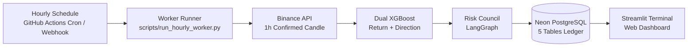

# Mudra: Bitcoin Quantitative ML & Autonomous Trading Terminal

[](https://mudra-trading.streamlit.app)
[](https://github.com/MohitSingh-2335/Mudra/actions)
[](tests/)
[](https://www.python.org/)
[](https://neon.tech)
[](docker-compose.yml)
[](LICENSE)

Mudra is a machine learning trading platform for Bitcoin (`BTC/USDT`). It uses two tuned XGBoost models (one for price return, one for direction), a 2-node risk evaluation council, delayed prediction verification, and an automated paper trading ledger on PostgreSQL.

**Live Web Application:** [mudra-trading.streamlit.app](https://mudra-trading.streamlit.app)

---

## Project Overview

Most machine learning models for crypto fail in real markets because of two common mistakes:
1. **Data Leakage (Lookahead Bias):** Randomly shuffling time-series data lets future price patterns leak into training. Mudra uses a strict chronological split: training on past data (2021 to mid-2025) and testing on 7,000 out-of-sample hours (mid-2025 to 2026).
2. **Ignoring Trading Fees:** Trading on every small signal burns capital quickly through exchange taker fees (0.05% per side) and slippage (0.02% per side, or 0.07% per fill). Mudra only enters an active trade when the model's expected return clears the canonical ~0.14% (`0.139951%`) round-trip break-even hurdle rate.

### Key Results
During the historical Phase 1 out-of-sample study (7,000 hours evaluated under a legacy 0.30% round-trip friction assumption) where Bitcoin dropped **-45.2%**, Mudra filtered out 96% of low-conviction chop trades and held USDT cash, recording **+33.55 percentage points of historical excess return (Alpha)** over Buy & Hold (historical benchmark provenance; not evidence of equivalent performance under the current canonical `0.139951%` friction).

| Strategy | Total Return | Max Drawdown | Total Trades | Exposure Time |
| :--- | :---: | :---: | :---: | :---: |
| **Buy & Hold Bitcoin** | -45.24% | -53.74% | 1 | 100.0% |
| **Basic Classifier (No Fee Filter)** | -97.56% | -97.56% | 1,237 | 57.9% |
| **Mudra (Fee Hurdle Gated)** | **-11.69%** | **-11.69%** | **49** | **0.77%** |


---

## System Architecture

Mudra runs automatically every hour in a clean, decoupled pipeline:



### How the Pipeline Works:
1. **Trigger:** An external cron ping wakes up the worker at minute 0 of every hour.
2. **Data & Features:** The worker downloads the latest confirmed 1-hour candle from Binance and builds 26 regression and 39 classification features across price action, order flow, sentiment, and on-chain telemetry.
3. **ML Inference:** The Regressor predicts next-hour percentage return and price target. The Classifier predicts price direction (`UP` / `DOWN`) and probability.
4. **Risk Review:** A 2-node LangGraph council checks if the return clears the fee hurdle and ensures volatility is within safe limits.
5. **Reconciliation:** The worker evaluates the prediction made in the previous hour ($T-1$) against the actual candle close at hour $T$, tagging accuracy and errors.
6. **Database:** Ticks, audit decisions, paper portfolio balances, and reconciliation results are saved to Neon PostgreSQL.

---

## Core Technologies

* **Machine Learning:** XGBoost (tuned with Optuna Bayesian optimization across 500 walk-forward fits).
* **Explainability:** TreeSHAP for calculating game-theoretic feature importance on every prediction.
* **Agentic Risk Council:** LangGraph state graph with a Strategist node and a Risk Critic node.
* **Cloud Database:** Neon Serverless PostgreSQL storing 5 tables (`MarketTick`, `ApiTelemetry`, `CouncilAudit`, `Reconciliation`, `PaperPortfolio`).
* **Serving & Frontend:** FastAPI for REST endpoints, Streamlit for the dark-theme terminal interface.
* **Containers:** Docker and Docker Compose for reproducible builds.

---

## Quickstart

### Run with Docker (Recommended)
```bash
git clone https://github.com/MohitSingh-2335/Mudra.git
cd Mudra
docker compose up --build
```
* Dashboard: `http://localhost:8501`
* API Docs: `http://localhost:8000/docs`

### Run Locally with Python
```bash
conda create -n mudra python=3.11 -y
conda activate mudra
pip install -r requirements.txt

# 1. Launch Streamlit Terminal Dashboard
streamlit run app.py

# 2. Launch FastAPI Intelligence Microservice
uvicorn src.api.main:app --host 0.0.0.0 --port 8000

# 3. Trigger Hourly Ingestion & Reconciliation Worker Manually
python scripts/run_hourly_worker.py --force
```

### Run Automated Tests
```bash
pytest tests/ -v
```
All **20 unit tests pass** across API endpoints, agent nodes, and database models.

---

## Details & Explanations

<details>
<summary><b>Delayed Ground Truth Reconciliation</b></summary>

<br>

Evaluating a price prediction at the moment it is made does not reflect reality. Mudra enforces delayed reconciliation:
* **At Hour T:** The model predicts where the price will be at Hour T+1. This is stored as pending.
* **At Hour T+1:** Once the new candle confirms, the actual price is compared to the saved prediction.
* **Error Categories:**
  * `ACCURATE`: Direction matched and price error is under 1.5%.
  * `DIRECTION_MISMATCH`: Predicted UP but market went DOWN (or vice versa).
  * `MAGNITUDE_ERROR`: Direction matched but price moved further than expected.
  * `BLACK_SWAN_OUTLIER`: Price moved more than 3.8% in a single hour.

</details>

<details>
<summary><b>TreeSHAP Feature Importance</b></summary>

<br>

Mudra uses TreeSHAP so every prediction has a clear mathematical explanation.


Top drivers of model decisions:
1. **Trading Volume (`volume`, `vol_mean_6h`):** High volume confirms trend strength, while low volume warns of fake breakouts.
2. **Taker Buy Ratio:** Measures whether aggressive buyers or sellers dominate the order flow.
3. **Fear & Greed Index (`fng_value`):** Macro sentiment indicator used to catch oversold and overbought conditions.

</details>

<details>
<summary><b>FastAPI Endpoints</b></summary>

<br>

Interactive documentation is available at `http://localhost:8000/docs` when running the API:

* `GET /health` — Check server and model status.
* `POST /predict` — Run inference on price and technical features.
* `POST /explain` — Get TreeSHAP feature contributions for a prediction.
* `POST /agents/trade` — Run the 2-node LangGraph risk council.
* `GET /reconciliation/summary` — Fetch current accuracy rate and error counts.
* `GET /portfolio/summary` — Fetch paper portfolio value, cash, and Alpha.

</details>

<details>
<summary><b>Repository Structure</b></summary>

<br>

```text
Mudra/
├── .github/workflows/       # Automated CI/CD and hourly worker workflow
├── artifacts/models/        # Tuned XGBoost regressor and classifier models
├── data/                    # Raw and processed historical data
├── experiments/             # Walk-forward CV & zero-shot foundation models (Chronos, TimesFM, Moirai)
├── src/
│   ├── agents/              # LangGraph Strategist and Risk Critic nodes
│   ├── api/                 # FastAPI routes and Pydantic schemas
│   ├── database/            # Neon PostgreSQL connection and SQLAlchemy models
│   ├── engine/              # Reconciliation engine and hourly sync logic
│   ├── explainability.py    # TreeSHAP explainer module
│   └── ui/                  # Plotly chart visualizers
├── tests/                   # 20 automated unit tests (agents, API, database)
├── scripts/                 # Ingestion and run_hourly_worker.py execution runner
├── app.py                   # Streamlit web dashboard
├── config.py                # Central project configuration and feature lists
├── docker-compose.yml       # Docker Compose setup for API and UI
└── requirements.txt         # Project dependencies
```

</details>

---

## License

This project is licensed under the [MIT License](LICENSE). Built for educational and research purposes.
