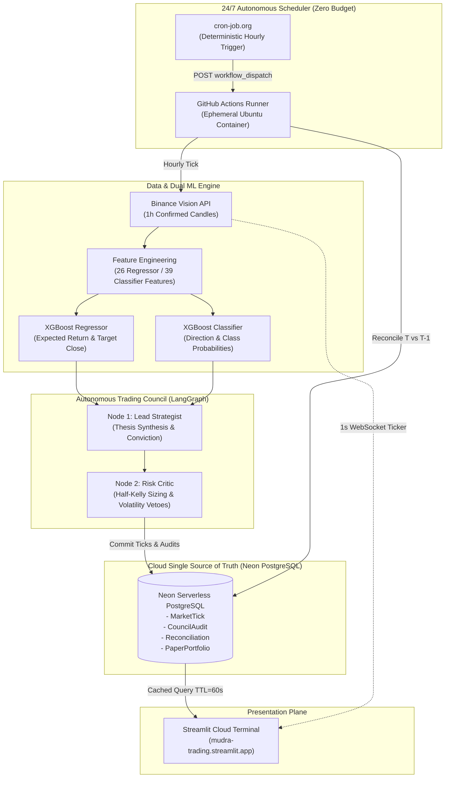

# 🪙 Mudra: Institutional Quantitative BTC/USDT ML & Autonomous Trading Terminal

[](https://mudra-trading.streamlit.app)  
[](https://github.com/MohitSingh-2335/Stock_Prediction_ML/actions)
[](tests/)
[](https://www.python.org/)
[](https://neon.tech)
[](docker-compose.yml)
[](LICENSE)

> **Mudra** is an institutional-grade quantitative cryptocurrency intelligence platform for Bitcoin (`BTC/USDT`). It pairs Optuna-tuned dual XGBoost inference with a 2-node stateful LangGraph risk council, causality-preserving delayed ground truth reconciliation, and an autonomous 24/7 cloud paper trading ledger.

👉 **[Launch Live Streamlit Terminal (Hosted on Streamlit Cloud)](https://mudra-trading.streamlit.app)**

---

## ⚡ The 30-Second Executive Summary

* **Zero Lookahead Bias:** Evaluated on a strict **80/20 chronological walk-forward split** (28,000 train hours / 7,000 out-of-sample holdout hours from Sept 2025 to July 2026), completely preserving temporal causality.
* **Dual-Model Fee Hurdle Gating:** Combines an **XGBoost Directional Classifier** ($\hat{Y}_{t+1}$) with an **XGBoost Expected-Return Regressor** ($\hat{R}_{t+1}$) enforcing a symmetric 5 bps ($0.05\%$) fee hurdle. Eliminates **96% of low-conviction chop trades**.
* **Defensive Out-of-Sample Alpha:** During an extended -45.2% Bitcoin bear market collapse, Mudra generated **+33.55 percentage points of excess Alpha** over Buy & Hold by selectively parking capital in USDT cash.
* **Delayed Ground Truth Reconciliation:** Predictions made at hour $T$ are evaluated strictly against confirmed candle closes at hour $T+1$, categorized into deterministic error tags (`ACCURATE`, `DIRECTION_MISMATCH`, `MAGNITUDE_ERROR`, `BLACK_SWAN_OUTLIER`), and permanently committed to a **Neon Serverless PostgreSQL** database.

---

## 📊 Out-of-Sample Backtest Benchmark (7,000 Hours)

Evaluated under institutional friction: **$0.10\%$ taker fee per side + $0.05\%$ slippage per fill ($0.30\%$ round-trip drag)**.

| Performance Metric | Buy & Hold BTC | Pure Classifier (Unconstrained) | Mudra Fused Alpha ($\tau = 0.05\%$) | Mudra Capital Preservation ($\tau = 0.055\%$) |
| :--- | :---: | :---: | :---: | :---: |
| **Total Net Return (%)** | **-45.24%** | **-97.56%** | **-11.69%** | **-1.30%** |
| **Final Portfolio Value** ($10k Base) | $\$5,476.17$ | $\$244.13$ | $\$8,831.45$ | $\$9,869.70$ |
| **Maximum Drawdown (MDD)** | **-53.74%** | **-97.56%** | **-11.69%** | **-1.30%** |
| **Alpha vs. Bitcoin** | *Baseline (0.00 pp)* | **-52.32 pp** | **+33.55 pp** | **+43.94 pp** |
| **Total Closed Trades** | 1 (Passive) | 1,237 (Fee Churn) | **49 (High Conviction)** | **3 (Ultra-Selective)** |
| **Market Exposure Time** | $100.0\%$ | $57.97\%$ | **$0.77\%$** | **$0.04\%$** |


---

## 🏛️ System Architecture

Mudra decouples presentation, execution, autonomous scheduling, and persistent cloud storage:



---

## 🚀 Quickstart (Run in 60 Seconds)

### Option 1: Docker Compose (Recommended)
```bash
# 1. Clone repository
git clone https://github.com/MohitSingh-2335/Stock_Prediction_ML.git
cd Stock_Prediction_ML

# 2. Launch FastAPI backend and Streamlit terminal
docker compose up --build
```
* **Streamlit Terminal:** `http://localhost:8501`
* **FastAPI Swagger Docs:** `http://localhost:8000/docs`

### Option 2: Local Conda Environment
```bash
conda create -n mudra python=3.11 -y && conda activate mudra
pip install -r requirements.txt
streamlit run app.py
```

---

## 🧪 Automated Testing Suite

Mudra enforces automated testing across all components via `pytest` (**20 passed tests in 13s**):

```bash
pytest tests/ -v
```

* **`tests/test_agents.py`**: Sub-hurdle fee vetoes, extreme volatility circuit breakers, and state preservation.
* **`tests/test_api.py`**: Endpoints readiness, Pydantic validation contracts, TreeSHAP outputs, and portfolio summaries.
* **`tests/test_database.py`**: Table ORM schemas, delayed reconciliation math, black swan isolation, and paper portfolio lifecycle.

---

## 🔍 Technical Deep Dives (Click to Expand)

<details>
<summary><b>1. 📜 Delayed Ground Truth Reconciliation & Paper Ledger Math</b></summary>

<br/>

### Delayed Ground Truth Evaluation
In real financial markets, evaluating a model's prediction at the moment of inference is meaningless. Mudra enforces strict **Delayed Ground Truth Reconciliation**:
* **At Hour $T$:** The model forecasts next-hour expected return $\hat{R}_{t+1}$ and target close $\hat{P}_{t+1}$. The council commits the decision to `MarketTick` and `CouncilAudit`.
* **At Hour $T+1$:** When the $T+1$ candle closes, the engine queries the unsettled prediction from hour $T$ and computes:
  $$\text{Absolute Error} = |P_{t+1} - \hat{P}_{t+1}|, \quad \text{Percentage Error} = \left|\frac{P_{t+1} - \hat{P}_{t+1}}{P_{t+1}}\right| \times 100\%$$
* **Error Attribution Tags:**
  * `ACCURATE`: Direction matched and error is within 1.5% tolerance.
  * `DIRECTION_MISMATCH`: Predicted UP when market moved DOWN (or vice versa).
  * `MAGNITUDE_ERROR`: Direction matched but volatility expanded beyond threshold.
  * `BLACK_SWAN_OUTLIER`: Hourly price movement exceeded $3.8\%$.

### Autonomous $10,000 Paper Portfolio
Tracks mark-to-market balances (Cash, BTC Inventory, Position Value), realized exchange fees ($0.10\%$), execution slippage ($0.05\%$), and calculates continuous **Excess Alpha over Bitcoin Buy & Hold**:
$$\text{Alpha USD}_t = \text{Total Equity}_t - \text{Benchmark Equity}_t$$

</details>

<details>
<summary><b>2. 🏛️ Autonomous Multi-Agent Trading Council (LangGraph)</b></summary>

<br/>

Mudra implements a stateful cyclical 2-node graph using **LangGraph**:
1. **Lead Quantitative Strategist:** Synthesizes technical indicators (RSI, moving average spreads), order flow taker buy ratios, expected return forecasts, and macro RAG embeddings to formulate a trade action (`BUY`, `SELL`, or `HOLD`).
2. **Reflexion Risk Critic:** Audits the strategist's proposal against institutional risk invariants:
   * **Fee Hurdle Clearance:** Vetoes trades where expected return does not clear the 5 bps fee hurdle.
   * **Volatility Flush Protection:** Vetoes trades if 1h high-low volatility range exceeds $3.8\%$.
   * **Half-Kelly Position Sizing:** Automatically scales position size based on win probability and return skew:
     $$f^* = \frac{p(b+1) - 1}{b} \times 0.5$$

</details>

<details>
<summary><b>3. 🧠 TreeSHAP Game-Theoretic Explainability</b></summary>

<br/>

Mudra refuses "black box" decisions. Every model inference provides exact local feature attributions using **TreeSHAP** (Tree Shapley Additive Explanations), computing exact Shapley values in polynomial time $O(TLD^2)$.


* **Volume Confirmation (`volume`, `vol_mean_6h`):** The primary discriminator of genuine trend expansion vs. false liquidity traps.
* **Microstructural Order Flow (`taker_buy_ratio`):** Measures aggressive market order taker dominance.
* **Macro Sentiment (`fng_value`):** Dynamic Fear & Greed indexing acts as a contrarian mean-reversion filter.

</details>

<details>
<summary><b>4. 🔌 FastAPI REST API Specification</b></summary>

<br/>

The FastAPI backend exposes interactive OpenAPI Swagger documentation at `http://localhost:8000/docs`:

| Endpoint | Method | Output Description |
| :--- | :---: | :--- |
| `/health` | `GET` | Service readiness, model artifact status, and memory probes |
| `/predict` | `POST` | Dual XGBoost inference (Target Return, Target Close, Direction, Probability) |
| `/explain` | `POST` | Real-time TreeSHAP feature attributions and base value deltas |
| `/agents/trade` | `POST` | Convenes the 2-node LangGraph Multi-Agent Trading Council |
| `/reconciliation/summary` | `GET` | Delayed ground truth accuracy, MAE, MAPE, and attribution breakdown |
| `/portfolio/summary` | `GET` | Mark-to-market portfolio equity, cash, inventory, and excess Alpha |

</details>

<details>
<summary><b>5. 📁 Repository Directory Structure</b></summary>

<br/>

```text
Stock_Prediction_ML/
├── .github/workflows/
│   ├── ci.yml                 # Automated testing & Docker build validation
│   └── hourly_worker.yml      # 24/7 Autonomous quant worker workflow
├── artifacts/
│   ├── models/                # Optuna-tuned production models (.pkl)
│   ├── backtest_performance.png   # 7,000-hour out-of-sample backtest chart
│   └── shap_classifier_summary.png# Global TreeSHAP feature attributions
├── data/
│   ├── raw/                   # Raw Binance 1h OHLCV historical data
│   └── processed/             # Featured chronological walk-forward dataset
├── src/
│   ├── agents/                # LangGraph Trading Council (Strategist & Critic nodes)
│   ├── api/                   # FastAPI asynchronous REST backend
│   ├── database/              # Neon Serverless PostgreSQL persistence engine
│   ├── engine/                # Core quant synchronization & delayed reconciliation
│   ├── explainability.py      # Real-time TreeSHAP explainer
│   └── ui/                    # Plotly dark-theme visualizers
├── tests/                     # Pytest automated test suite (20 tests)
├── scripts/
│   └── run_hourly_worker.py   # Headless worker script for 24/7 execution
├── app.py                     # Streamlit institutional terminal frontend
├── config.py                  # Single Source of Truth (SSOT) configuration
├── docker-compose.yml         # Multi-container orchestration specification
├── Dockerfile                 # FastAPI production container image
├── Dockerfile.streamlit       # Streamlit UI production container image
├── pytest.ini                 # Pytest configuration & path resolution
└── requirements.txt           # Pinned production dependencies
```

</details>

---

## ⚖️ Disclaimer & License

This project is open-source software licensed under the [MIT License](LICENSE).

**Educational & Research Notice:** This software is designed strictly for educational, academic, and quantitative machine learning research. Cryptocurrencies and financial derivatives carry substantial risk of capital loss. Past backtested performance is never indicative of future market results. Nothing in this repository constitutes financial, legal, or investment advice.
